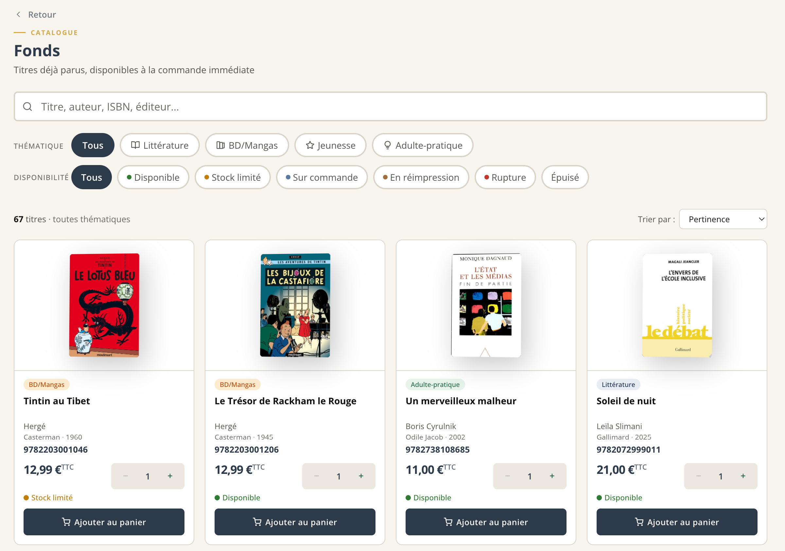
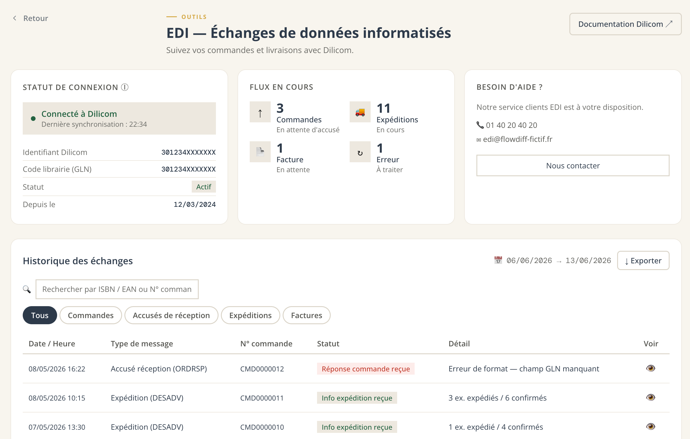

# 📚 FlowDiff : Plateforme B2B de commande de livres pour libraires

> **Application de démonstration conçue et construite de bout en bout en pilotant l'IA (Claude Code).**
> Un cas concret de *Product Owner augmenté par l'IA* : de la vision produit et des règles métier jusqu'au produit livré, testé et déployé.

<p>
  
  
  
  
</p>

**🔑 Connexion de démonstration :** cliquer directement sur **Se connecter**.
 
 📸  

---

## 🎯 Le produit

**FlowDiff** est le portail de démonstration d'un diffuseur-distributeur fictif, à destination des libraires. Il distingue deux parcours, tous deux fictifs :

- les commandes créées dans le panier, enregistrées depuis le **site FlowDiff** ;
- les commandes externes simulées depuis la page **EDI**, comme si elles provenaient du logiciel de gestion habituel du libraire.

Le démonstrateur ne se connecte pas à Dilicom et ne transmet aucune commande réelle. Il réunit aussi :

- la **commande** de fonds, nouveautés, top ventes et sélections éditoriales,
- un **tableau de bord** d'activité (volumes, montants, top éditeurs, taux de rupture…),
- une **simulation de suivi EDI** inspirée de Dilicom, sans connexion ni transmission réelle,
- la **facturation** et l'historique, avec remises personnalisées par librairie.

> 💡 L'enjeu n'était pas « faire une app » mais **modéliser un domaine métier réel** (chaîne du livre, remises, TVA, EDI) et le traduire en un produit utilisable.

---

## ✨ Fonctionnalités livrées

| Domaine | Ce qui est implémenté |
|---|---|
| **Catalogue** | Fonds, Nouveautés, À paraître, Top ventes, Sélections · recherche + filtres par univers · fiches produit · couvertures locales dans `public/covers` |
| **Commande** | Panier avec remises et calculs de démonstration, vérification des adresses, validation depuis le site FlowDiff |
| **Simulation EDI** | Depuis la page EDI uniquement : création d'une commande externe fictive et génération immédiate, pour la démonstration, des messages **ORDERS**, **ORDRSP** et **DESADV** |
| **Tableau de bord** | KPIs, courbes d'évolution, répartition par univers, top éditeurs, comparaison N-1, **exports CSV** par section, personnalisation des cartes (drag & drop) |
| **Facturation** | Factures PDF fictives générées à la volée ; aucun paiement réel n'est encaissé |
| **Compte & historique** | Profil fictif, remises et adresse de démonstration, historique distinguant « Site FlowDiff » et « EDI — simulation » |
| **Onboarding** | Tour guidé (Driver.js) + infobulles métier |
| **UX** | Responsive **360 px → 1400 px**, design system maison, accessibilité (touch ≥ 44 px, contrastes WCAG AA) |

---

## 🧠 Règles métier modélisées *(le cœur du travail produit)*

- **À paraître commandable** : le type « A paraître » est conservé sur la ligne de commande pour distinguer ce cas métier.
- **Remises de démonstration** par librairie et par thématique, appliquées automatiquement depuis les données locales.
- **TVA livre à 5,5 %** : chaîne de prix cohérente : prix public **HT** (donnée source) → TTC → prix net après remise.
- **EDI inspiré de Dilicom** : un seul distributeur fictif, références de commande et structure illustrative ; aucune intégration réelle.
- **Isolation des données par `codeClient`** : panier et historique partagés au sein d'une librairie, jamais entre librairies.
- **B2B exclusif simulé** : inscription et comptes de démonstration stockés localement.

---

## 🤖 Construit en pilotant l'IA

Ce projet a été **spécifié, développé, revu et testé en orchestrant Claude Code**, et c'est volontaire : il illustre la posture d'un **Product Owner qui livre, pas seulement qui rédige des tickets**.

Concrètement, mon rôle sur ce produit :

- **Discovery & cadrage** : définition du domaine, des personas (libraires), des règles métier et du périmètre.
- **Spécification exécutable** : découpage en phases, critères d'acceptation, charte graphique et design system.
- **Pilotage de l'IA** : rédaction de prompts précis, décomposition des tâches, revue de code, arbitrages techniques (stack, structure de données, sécurité).
- **Qualité** : TypeScript strict, tests Vitest, vérification systématique avant de considérer une tâche « terminée ».

> 🎙️ *La compétence démontrée : transformer une intention produit en logiciel fonctionnel en utilisant l'IA comme force de réalisation : du métier au déployé.*

---

## 🛠️ Stack technique

- **Vite 5 + React 18** : SPA, **React Router v6**
- **TypeScript** (mode strict)
- **Styled-components v6** : design system & thème centralisé (`src/lib/theme.ts`)
- **Données locales** : catalogue mock et couvertures servies depuis `public/covers`
- **Zod** : validation de toutes les entrées
- **bcryptjs** : hachage des mots de passe (auth mock)
- **Vitest** : tests unitaires (logique métier : calcul des totaux, commandabilité…)
- **Vercel** : configuration de déploiement statique présente ; aucun service serveur n'est utilisé

---

## ▶️ Tester en 30 secondes

**En ligne :** ouvre la démo → clique sur *Se connecter*.

**En local :**

```bash
npm install
npm run dev      # http://localhost:5173
```

```bash
npm run test     # lance la suite Vitest
npm run build    # build de production (tsc + vite)
```

---

## 📸 Captures


| Tableau de bord | Catalogue | EDI EDIFACT |
|---|---|---|
|  |  |  |


---

## 📌 Périmètre & limites (assumés)

C'est une **application de démonstration** :

- **Données fictives** (livres, librairies, commandes) à des fins pédagogiques.
- **Stockage local uniquement** : catalogue embarqué et données utilisateur dans le `localStorage` du navigateur ; aucune base de données, API ou intégration AS400/CRM active.
- **EDI fictif** : Dilicom est une référence métier, sans connexion, partenariat ni échange effectif. Le panier ne propose aucun choix EDI ; l'EDI se simule exclusivement depuis sa page dédiée.
- **Emails et paiements non opérationnels** : les libellés et documents sont illustratifs ; aucun message ni paiement réel n'est envoyé ou encaissé.
- **Authentification simplifiée** (mock JWT en `localStorage`) : pas destinée à la production.
- Certaines sections sont **en cours** et affichées comme telles (ex. *Mon office* → « Bientôt disponible »).

Ces choix sont délibérés : l'objectif est de démontrer la **conception produit, la modélisation métier et la capacité à livrer**, pas de mettre une app en production.

---

## 👤 À propos

Projet réalisé par un **Product Owner spécialisé IA**, pour illustrer une approche *AI Product Builder* : concevoir et livrer un produit complet en pilotant l'intelligence artificielle.

📬 *N'hésitez pas à me contacter pour échanger sur la démarche produit ou le pilotage de l'IA.*
