# Workflow d'un ticket, en 5 etapes

Le deroule complet d'un ticket, tel qu'il est outille par ce kit, en 5 etapes numerotees. **Chaque etape a exactement un point d'entree** : un subagent de plan des tests, un skill qui orchestre les deux writers test-first, un skill d'ecriture du code jusqu'au vert, un skill qui lance les subagents de review, puis 2 skills pour ouvrir la PR et la merger.

Ce workflow suppose un projet qui suit un board de tickets (`TICKET_SOURCE` renseigne dans `PROJECT_CONTEXT.md`) et une stack testable en unitaire. S'il n'y a pas de board, remplacer les etapes qui le supposent par une simple description du besoin en texte libre : la doctrine de test et la discipline test-first restent valables.

## Vue d'ensemble

```mermaid
flowchart TD
    START(["Ticket en cours<br/>regles metier (RM)"])

    subgraph S1 ["Etape 1 - Planifier les tests"]
        INV["test-planner<br/>classe chaque RM :<br/>🟢 unitaire - 🟠 mixte - 🔴 manuel"]
        INVOUT[/"testing/inventaire-&lt;ID&gt;.md"/]
        INV --> INVOUT
    end

    subgraph S2 ["Etape 2 - Ecrire les tests, test-first, AVANT le code"]
        WT["/write-tests<br/>lit l'inventaire, decide qui a du travail,<br/>lance les writers EN PARALLELE (1 fois chacun)"]
        TFU["unit-test-writer<br/>tests unitaires ROUGES<br/>RM 🟢 + part unitaire des 🟠"]
        TFS["smoke-test-writer<br/>scenarios manuels<br/>RM 🔴 + complement des 🟠"]
        TFUOUT[/"tests unitaires (rouges)"/]
        TFSOUT[/"testing/smokes-&lt;ID&gt;.md"/]
        WT --> TFU --> TFUOUT
        WT --> TFS --> TFSOUT
    end

    subgraph S3 ["Etape 3 - Ecrire le code, jusqu'au vert"]
        IMPL["/write-code<br/>logique metier -> cablage<br/>(mode plan si dependance / migration)"]
        VERIF{"Tests verts ?<br/>test + typecheck + lint"}
        SMOKE["Smokes de la tranche joues<br/>-> cases cochees"]
        ALL{"Tout le ticket au vert ?"}
        IMPL --> VERIF
        VERIF -- non, corriger --> IMPL
        VERIF -- oui --> SMOKE --> ALL
        ALL -- non, tranche suivante --> IMPL
    end

    subgraph S4 ["Etape 4 - Review le code"]
        RC["/review-code + /security-review<br/>preparent le contexte, lancent les agents,<br/>restituent la revue telle quelle"]
        REV["code-reviewer + security-reviewer<br/>defauts classes ⛔ / ⚠️ / 💡<br/>(ne modifient aucun fichier)"]
        BLOCK{"Defaut bloquant ⛔ ?"}
        RC --> REV --> BLOCK
    end

    subgraph S5 ["Etape 5 - Merger le code"]
        GATE{"/open-pr - verrou qualite<br/>lint + typecheck + test"}
        PUSH["git push de la branche"]
        PR["Ouvre la PR vers la branche de base"]
        STOP{"⛔ STOP<br/>accord humain, PR par PR"}
        MERGE["/merge-pr<br/>merge la PR<br/>ticket -> statut pret a tester"]
        GATE -- rouge --> IMPL
        GATE -- vert --> PUSH --> PR --> STOP
        STOP -- accord donne --> MERGE
    end

    START --> INV
    INVOUT --> WT
    TFUOUT --> IMPL
    TFSOUT --> IMPL
    ALL -- oui --> RC
    BLOCK -- oui, corriger --> IMPL
    BLOCK -- non --> GATE
```

## Les phases en detail

### Etape 1 - Planifier les tests

Le subagent `test-planner` prend le ticket et classe chaque regle metier (RM). Sa sortie s'appelle `testing/inventaire-<TICKET_ID>.md`, c'est le meme objet que le plan des tests.

| Etat | Sens | Verifie par |
|---|---|---|
| 🟢 | ce qu'on verifie est du code a nous (validation, transformation, mapping d'erreur) | test unitaire, dependances mockees |
| 🟠 | une tranche a nous (unitaire) + une tranche reelle qu'aucun smoke ne couvre | test unitaire **et** smoke manuel |
| 🔴 | ce qu'on verifie est le comportement reel d'une dependance et son branchement | smoke manuel uniquement |

Sortie : `testing/inventaire-<TICKET_ID>.md`. C'est lui qui fixe le perimetre des deux subagents test-first, qui peuvent tourner **en parallele** (perimetres disjoints).

### Etape 2 - Ecrire les tests (test-first, avant toute implementation)

**Tous les tests du ticket sont ecrits d'un coup, avant la moindre ligne de code**, pas paquet par paquet. Deux raisons : l'implementation a besoin de voir la **spec complete de chaque fonction** pour l'ecrire en une fois, et les tests se derivent du ticket et du contrat, qui sont deja tranches, il n'y a rien a apprendre de l'implementation pour les ecrire.

Point d'entree unique : le skill **`/write-tests`**. Il lit l'inventaire, decide lesquels des deux writers ont du travail (un ticket sans 🔴 ni 🟠 ne lance pas le smoke-writer), et les lance **en parallele, une seule fois chacun**, leurs fichiers sont disjoints. Il n'ecrit lui-meme aucun test.

- `unit-test-writer` ecrit les tests unitaires des RM 🟢 et de la part unitaire des 🟠. Ils sont **rouges par construction** : l'implementation n'existe pas.
- `smoke-test-writer` ecrit les scenarios manuels (preconditions, etapes, resultat attendu) des RM 🔴 et du complement des 🟠, dans `testing/smokes-<TICKET_ID>.md`, une case a cocher par scenario.

Les deux fichiers jouent le meme role : fixer le cahier des charges avant d'ecrire le code.

### Etape 3 - Ecrire le code, jusqu'au vert

`/write-code` fait passer au vert les tests rouges ecrits a l'etape 2. Le cahier des charges, ce sont eux ; a defaut, les smokes + le ticket, rien de plus, rien de moins.

- **Decision structurante** (nouvelle dependance, migration de schema, fichier hors des couches etablies) : mode plan d'abord, execution apres accord.
- L'implementation suit les couches et conventions declarees dans les rules du repo (`ARCHITECTURE_DOC` dans `PROJECT_CONTEXT.md`, s'il existe).

**On n'impose pas de decoupage a cette etape**, et c'est delibere. Les paquets du ticket groupent les RM **par theme**, alors que le code groupe **par fonction**. Comme tous les tests rouges existent deja, l'unite se lit d'elle-meme : on ouvre un fichier de test, on ecrit la fonction **en entier**, on passe au suivant.

**Verification, a chaque tranche :**

- Tests verts (`TEST_COMMAND`), ou pour du code sans tests unitaires (branchement d'une dependance, cablage) : l'application demarre et repond.
- `TYPECHECK_COMMAND`, si le langage est type.
- `LINT_COMMAND`, garanti par le **hook Stop** (`.claude/hooks/quality-gate.sh`) : a chaque fin de tour de l'agent, le harnais lance la verification et bloque tant qu'il y a des erreurs.
- Les smokes correspondants sont executes et leurs cases cochees. **Les jouer au fil de l'eau, pas tous a la fin** : c'est le seul moyen de decouvrir tot qu'un mock ne correspond pas a la realite.

Quand toute la suite est verte et les smokes coches, on passe a la review.

### Etape 4 - Review le code

`/review-code` prepare le contexte puis lance `code-reviewer`, qui relit le diff complet de la branche pour tout ce qui n'est pas la securite (correction, lisibilite, maintenabilite, performance, conventions). `/security-review` fait de meme pour `security-reviewer`, focalise sur l'authentification, les autorisations, l'exposition de donnees, les secrets et les dependances. Les deux **ne modifient aucun fichier** : ils rendent une revue classee par gravite, chaque defaut prefixe de son marqueur (⛔ bloquant, ⚠️ a corriger, 💡 suggestion), avec l'emplacement, le mecanisme concret et une correction proposee. Un defaut ⛔ (de l'un ou l'autre agent) renvoie a l'implementation ; sinon on ouvre la PR.

### Etape 5 - Merger le code

Deux skills, separes par un accord humain.

**`/open-pr`** amene le travail jusqu'a la PR, sans merger :

1. **Verrou qualite** bloquant : `LINT_COMMAND`, `TYPECHECK_COMMAND`, `TEST_COMMAND`. Au premier rouge, on s'arrete, rien n'est pousse.
2. `git push` de la branche feature.
3. **PR ouverte vers `BASE_BRANCH`**, corps derive des commits.
4. **STOP.** Le merge est une decision humaine explicite, donnee pour cette PR precise (`.claude/rules/git.md`). Le skill s'arrete la.

**`/merge-pr`**, une fois l'accord donne, merge la PR de la branche courante et passe le ticket au statut "pret a tester" (si le projet a un board).

## Ce que chaque phase produit

| Phase | Livrable |
|---|---|
| Etape 1 - Planifier les tests | `testing/inventaire-<ID>.md` |
| Etape 2 - Ecrire les tests | tests unitaires (rouges) + `testing/smokes-<ID>.md` |
| Etape 3 - Ecrire le code | code applicatif, suite verte, cases smoke cochees |
| Etape 4 - Review le code | revue classee ⛔ / ⚠️ / 💡 (aucun fichier modifie) |
| Etape 5 - Merger le code | PR ouverte vers `BASE_BRANCH`, puis mergee apres accord, ticket au statut "pret a tester" |
